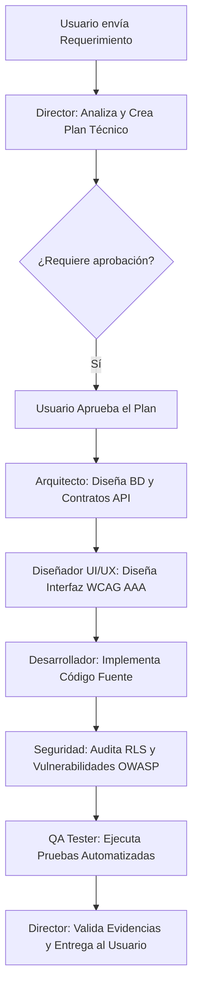

# 🚀 TUTORIAL MAESTRO: 🚀 TUTORIAL MAESTRO: CÓMO USAR Y QUÉ PUEDES CONSTRUIR CON EL AI_DEV_TEAM

Este tutorial te guiará paso a paso para dominar tu equipo de ingeniería con Inteligencia Artificial Multiagente (AI_DEV_TEAM) ubicado en C:/Users/51969/Desktop/AI_DEV_TEAM.

1. ¿Qué es el AI DEV TEAM?

El AI DEV TEAM es una infraestructura de desarrollo compuesta por 12 Agentes de IA Especialistas, 32 Habilidades (Skills) de ingeniería y Flujos de Trabajo Estandarizados.

A diferencia de usar la IA como un simple "chat de código general", el AI DEV TEAM transforma a la IA en una célula de ingeniería completa de nivel empresarial:

                              [ USUARIO / CLIENTE ]

                                        │

                                        ▼

                           [ DIRECTOR / ORQUESTADOR ]

                                ([director.md](http://director.md))

                                        │

         ┌──────────────────────────────┼──────────────────────────────┐

         ▼                              ▼                              ▼

  [ ARQUITECTO ]                [ DESARROLLADOR ]               [ QA TESTER ]

  ([architect.md](http://architect.md))                ([developer.md](http://developer.md))                   ([tester.md](http://tester.md))

         │                              │                              │

         ▼                              ▼                              ▼

 [ AUDITOR SEGURIDAD ]         [ DISEÑADOR UI/UX ]           [ ING. RENDIMIENTO ]

   ([security.md](http://security.md))                  ([ui-ux.md](http://ui-ux.md))                  ([performance.md](http://performance.md))

2. Los 12 Agentes Especialistas y Sus Funciones

Agente

Nombre en el Framework

Cuándo usarlo

👔 Director

.agents/agents/[director.md](http://director.md)

Para iniciar un proyecto, analizar requerimientos y coordinar al equipo.

🏛️ Arquitecto

.agents/agents/[architect.md](http://architect.md)

Para diseñar bases de datos, diagramar APIs, microservicios y tomar decisiones (ADRs).

💻 Desarrollador

.agents/agents/[developer.md](http://developer.md)

Para escribir código en React, Next.js, TypeScript, Kotlin, Swift, Flutter o Node.js.

🖥️ Dev Escritorio

.agents/agents/[desktop-developer.md](http://desktop-developer.md)

Para crear programas instalables de Windows/macOS/Linux con Tauri (Rust) o Electron.

📊 Ing. de Datos

.agents/agents/[data-engineer.md](http://data-engineer.md)

Para pipelines de datos, ClickHouse, BigQuery, dbt y analítica de datos.

🎮 Dev Videojuegos

.agents/agents/[game-developer.md](http://game-developer.md)

Para juegos 2D/3D con Unity/Godot y Realidad Aumentada (Android XR / VisionOS).

🧪 QA Tester

.agents/agents/[tester.md](http://tester.md)

Para crear y ejecutar pruebas unitarias, de integración y E2E (Vitest, Playwright).

🛡️ Seguridad AppSec

.agents/agents/[security.md](http://security.md)

Para auditar código contra vulnerabilidades OWASP Top 10, sanitización Zod y RLS.

⚡ Rendimiento

.agents/agents/[performance.md](http://performance.md)

Para corregir lentitud, optimizar Core Web Vitals (LCP, INP) y eliminar consultas N+1.

🎨 Diseñador UI/UX

.agents/agents/[ui-ux.md](http://ui-ux.md)

Para diseñar sistemas de componentes accesibles (WCAG 2.2 AAA), Tailwind y Shadcn UI.

🖌️ Diseñador Visual

.agents/agents/[visual-designer.md](http://visual-designer.md)

Para marcas, logotipos, paletas OKLCH e íconos vectoriales SVG limpios.

🔬 Investigador

.agents/agents/[researcher.md](http://researcher.md)

Para investigar librerías, comparar costos de APIs/LLMs y verificar compatibilidad.

3. ¿Qué puedes construir con este Framework? (Casos Reales)

Con la biblioteca de 32 Skills integrada, puedes crear desde cero:

1.

Plataformas Web Fullstack y SaaS Corporativos:

◦

Sistemas de gestión, ERPs, CRMs, plataformas educativas o financieras (Next.js 15, React 19, Supabase, Tailwind v4).

2.

Aplicaciones Móviles Nativas e Híbridas:

◦

Apps para Android (Kotlin, Jetpack Compose, Hilt) e iOS (Swift 6, SwiftUI) o híbridas con React Native / Flutter.

3.

Programas de Escritorio Instalables (Windows, macOS, Linux):

◦

Software nativo superligero con Tauri 2.0 (Rust) o Electron.

4.

Sistemas con Inteligencia Artificial Generativa y RAG:

◦

Chatbots autónomos, asistentes con búsqueda sobre documentos privados (pgvector/Pinecone) y llamadas a funciones (MCP).

5.

E-Commerce y Plataformas de Monitización:

◦

Tiendas virtuales con cobros por tarjeta/Yape/Plin (Stripe, Mercado Pago) y suscripciones móviles in-app (RevenueCat).

6.

Videojuegos 2D/3D y Computación Espacial:

◦

Juegos interactivos en Unity/Godot y experiencias para gafas inteligentes de Realidad Aumentada (Android XR).

4. Guía Práctica PASO A PASO: Cómo Iniciar un Proyecto Nuevo

Paso 1: Copiar el Framework a tu Proyecto Nuevo

Cuando crees una carpeta nueva para un proyecto (ejemplo: mi-nuevo-saas), copia dos cosas desde tu escritorio C:/Users/51969/Desktop/AI_DEV_TEAM:

1.

El archivo [AGENTS.md](http://AGENTS.md)

2.

La carpeta .agents/

Pegas ambos elementos en la raíz de tu proyecto nuevo:

mi-nuevo-saas/

├── [AGENTS.md](http://AGENTS.md)

└── .agents/

Paso 2: Invocar al Director en tu IDE

Abre tu IDE (VS Code, Cursor, Android Studio, IntelliJ, Windsurf) y en el chat del asistente de IA pega este Prompt Inicial:

Lee [AGENTS.md](http://AGENTS.md) y .agents/agents/[director.md](http://director.md). Actúa como Director del AI DEV TEAM. 

Analiza mi solicitud: "Quiero construir una plataforma SaaS de reservas para consultorios médicos con login, calendario interactivo y pagos con tarjeta", 

selecciona los especialistas y Skills necesarios, presenta un plan técnico y espera mi aprobación.

Paso 3: El Director genera el Plan Técnico

El Director revisará el proyecto y responderá estructurando el trabajo:

1.

Objetivo: Crear SaaS de reservas médicas.

2.

Arquitectura recomendada: Next.js 15, Supabase (Auth + PostgreSQL), Tailwind v4, Stripe.

3.

Especialistas convocados:

◦

architect: Diseñará la base de datos de pacientes/citas y la API.

◦

ui-ux: Diseñará el calendario interactivo con accesibilidad WCAG 2.2 AAA.

◦

developer: Escribirá el código React/TypeScript.

◦

security: Protegerá las historias clínicas con RLS y sanitización Zod.

◦

tester: Creará las pruebas con Vitest.

Paso 4: Ejecución por Especialistas (Trabajo en Equipo)

A. Invocas al Arquitecto para la Base de Datos:

"Lee .agents/agents/[architect.md](http://architect.md) y .agents/skills/backend/database-design-migrations/[SKILL.md](http://SKILL.md). Diseña el esquema SQL para pacientes, médicos y citas médicas."

B. Invocas al Diseñador UI/UX para las Pantallas:

"Lee .agents/agents/[ui-ux.md](http://ui-ux.md) y .agents/skills/frontend/design-systems-tailwind-shadcn/[SKILL.md](http://SKILL.md). Diseña la interfaz del calendario de reservas en modo claro y oscuro."

C. Invocas al Desarrollador para Escribir el Código:

"Lee .agents/agents/[developer.md](http://developer.md) y .agents/skills/frontend/nextjs-react-fullstack/[SKILL.md](http://SKILL.md). Implementa el código del componente de reservas."

D. Invocas al Auditor de Seguridad:

"Lee .agents/agents/[security.md](http://security.md) y .agents/skills/core/penetration-testing-owasp-top10/[SKILL.md](http://SKILL.md). Audita las políticas RLS y la seguridad de la API de reservas."

E. Invocas al QA Tester para Probar:

"Lee .agents/agents/[tester.md](http://tester.md) y .agents/skills/core/unit-testing/[SKILL.md](http://SKILL.md). Ejecuta las pruebas unitarias y confirma que no hay errores."

5. Guía Práctica: Cómo Corregir Bugs y Auditar Seguridad

Cuando tengas un error o quieras asegurar un proyecto existente:

Para Auditar Ciberseguridad (OWASP Top 10):

Pega este prompt en el chat de tu IDE:

"Lee .agents/agents/[security.md](http://security.md) y el flujo .agents/workflows/[security-audit.md](http://security-audit.md). Audita todo el proyecto buscando claves expuestas, vulnerabilidades XSS/SQLi y políticas RLS faltantes en Supabase. Entrega un reporte clasificado por CRÍTICO, ALTO, MEDIO y BAJO."

Para Resolver un Bug Difícil:

"Lee .agents/agents/[tester.md](http://tester.md) y el flujo .agents/workflows/[bug-fix.md](http://bug-fix.md). Analiza el siguiente error: [PEGA AQUÍ EL ERROR / STACK TRACE], aísla la causa raíz y propón la solución mínima sin generar regresiones."

6. Guía Práctica: Cómo Optimizar el Rendimiento

Si tu aplicación web o app móvil se siente lenta:

"Lee .agents/agents/[performance.md](http://performance.md) y .agents/skills/core/performance-basics/[SKILL.md](http://SKILL.md). Audita el proyecto en busca de componentes que se re-renderizan innecesariamente, consultas SQL N+1 y recursos pesados. Propón las optimizaciones."

7. Buenas Prácticas de Oro para Obtener Resultados 100% Profesionales

1.

Un Agente a la Vez: Deja que cada agente cumpla su rol especialista. No le pidas al Diseñador UI que configure Docker, ni al Auditor de Seguridad que dibuje logotipos.

2.

Exige Evidencias de Pruebas: NUNCA des por terminado un trabajo sin pedirle al agente Tester que ejecute npm test o npm run build y te muestre el resultado real.

3.

Cero Secretos: NUNCA permitas que la IA guarde contraseñas, tokens privados o claves service_role en archivos .js o .ts del cliente. Todo debe ir en .env (excluido por .gitignore).

4.

Céntimos para Dinero: Si tu app maneja montos financieros, recuérdale al Desarrollador usar céntimos enteros (2021 céntimos en lugar de 20.21 flotante) para evitar errores matemáticos.

¡Con este flujo de trabajo, tienes un Equipo de Ingeniería Completo listo para llevar cualquier idea a un producto terminado de nivel profesional!CÓMO USAR Y QUÉ PUEDES CONSTRUIR CON EL AI_DEV_TEAM

---

## 📋 ÍNDICE DEL MANUAL

1. **Visión General y Filosofía de Trabajo**
2. **Estructura del Equipo: 12 Agentes y 32 Skills**
3. **Casos de Uso Reales (¿Qué se puede construir?)**
4. **Flujo de Trabajo Multiagente (Diagrama de Arquitectura)**
5. **Guía Práctica Paso a Paso: Iniciar un Proyecto Nuevo**
6. **Guía Práctica Paso a Paso: Auditoría de Ciberseguridad OWASP Top 10**
7. **Guía Práctica Paso a Paso: Resolución de Bugs Complejos**
8. **Guía Práctica Paso a Paso: Optimización de Rendimiento**
9. **Tabla de Invocación Rápida por IDE y Agente**
10. **Reglas de Oro para un Resultado 100% Profesional**

---


## 1. VISIÓN GENERAL Y FILOSOFÍA DE TRABAJO

El **AI DEV TEAM** es una célula de ingeniería de software automatizada y guiada por Inteligencia Artificial. A diferencia de usar modelos de lenguaje como asistentes de chat genéricos, este framework transforma al asistente en un **equipo de desarrollo multiagente altamente especializado**.

> [!NOTE]
> **Filosofía del AI DEV TEAM:**
> Cada agente tiene un rol único, un conjunto asignado de habilidades (*Skills*) y un protocolo de calidad estricto. La combinación de estos especialistas garantiza software seguro, accesible, probado e íntegro financieramente.

---


## 2. ESTRUCTURA DEL EQUIPO: 12 AGENTES Y 32 SKILLS


### 👥 Cuadro de los 12 Agentes Especialistas


| Agente                   | Rol de Ingeniería            | Responsabilidad Principal                                                                     | Skills Asignados                                                                                                                                                           |
| ------------------------ | ---------------------------- | --------------------------------------------------------------------------------------------- | -------------------------------------------------------------------------------------------------------------------------------------------------------------------------- |
| 👔 **Director**          | Tech Lead & Orquestador      | Análisis de requerimientos, planes técnicos, gestión de riesgos y validación.                 | `planning`, `project-discovery`, `release-checklist`, `documentation`                                                                                                      |
| 🏛️ **Arquitecto**       | Systems & Database Architect | Clean Architecture, DDD, esquemas PostgreSQL, contratos OpenAPI 3.1 y ADRs.                   | `architecture`, `database-design-migrations`, `api-design-rest-graphql-grpc`, `cloud-infrastructure`                                                                       |
| 💻 **Desarrollador**     | Fullstack & Mobile Engineer  | Código modular en React 19, Next.js, Kotlin Compose, Swift 6 SwiftUI, Flutter/Expo, Céntimos. | `coding-standards`, `nextjs-react-fullstack`, `android-native-kotlin`, `ios-swift-swiftui`, `cross-platform-react-native-flutter`, `state-management`, `pwa-offline-first` |
| 🖥️ **Dev Escritorio**   | Desktop Apps Engineer        | Aplicaciones instalables para Windows/macOS/Linux con Tauri 2.0 (Rust) o Electron.            | `desktop-electron-tauri`, `coding-standards`, `security-basics`                                                                                                            |
| 📊 **Ing. de Datos**     | Data & Analytics Engineer    | Pipelines de datos ETL/ELT, dbt, ClickHouse, BigQuery y tableros analíticos.                  | `data-pipelines-etl-elt`, `data-warehousing-analytics`, `database-design-migrations`                                                                                       |
| 🎮 **Dev Videojuegos**   | Game & XR Engineer           | Juegos 2D/3D con Unity/Godot y Realidad Aumentada (Android XR / VisionOS).                    | `game-engine-unity-godot`, `spatial-computing-android-xr`, `performance-basics`                                                                                            |
| 🧪 **QA Tester**         | QA Automation Engineer       | Pirámide de pruebas (Unitarias, Integración, E2E con Vitest, Playwright, Maestro).            | `unit-testing`, `e2e-testing-playwright-cypress`, `debugging`                                                                                                              |
| 🛡️ **Seguridad AppSec** | AppSec & Security Auditor    | Auditorías OWASP Top 10, sanitización Zod, cabeceras HTTP y políticas RLS.                    | `security-basics`, `penetration-testing-owasp-top10`, `authentication-authorization-rbac`                                                                                  |
| ⚡ **Rendimiento**        | Performance Architect        | Core Web Vitals (INP, LCP, CLS), profiling con Perfetto y optimización SQL.                   | `performance-basics`, `monitoring-observability-sentry`                                                                                                                    |
| 🎨 **Diseñador UI/UX**   | UI/UX & Accessibility Lead   | Protocolo *Design System First*, tokens OKLCH, WCAG 2.2 AAA y micro-interacciones.            | `ui-ux-design`, `ui-accessibility`, `design-systems-tailwind-shadcn`                                                                                                       |
| 🖌️ **Diseñador Visual** | Visual & Brand Designer      | Identidad gráfica, logotipos, marcas, paletas cromáticas e íconos SVG.                        | Identidad de marca, iconografía SVG, gráficos vectoriales                                                                                                                  |
| 🔬 **Investigador**      | Technical Researcher         | Benchmarking de librerías, costos de LLMs y compatibilidad oficial.                           | `project-discovery`, `documentation`                                                                                                                                       |


---


## 3. CASOS DE USO REALES (¿QUÉ PUEDES CONSTRUIR?)

```
 ┌─────────────────────────────────────────────────────────────────────────┐
 │                   SISTEMAS QUE PUEDES CONSTRUIR                         │
 ├─────────────────────────────────────────────────────────────────────────┤
 │ 🌐 SaaS Web & Webapps (Next.js 15, React 19, Supabase, Tailwind v4)    │
 │ 📱 Apps Móviles Nativas e Híbridas (Android Kotlin, iOS SwiftUI, Expo)  │
 │ 🖥️ Programas de Escritorio Instalables (Windows, macOS, Linux con Tauri)│
 │ 🤖 Plataformas de IA Generativa & RAG (LangChain, pgvector, MCP)        │
 │ 💳 E-Commerce & Monetización (Stripe, Mercado Pago, RevenueCat)         │
 │ 🎮 Videojuegos 2D/3D & Computación Espacial (Unity, Godot, Android XR)  │
 └─────────────────────────────────────────────────────────────────────────┘
```

---


## 4. FLUJO DE TRABAJO MULTIAGENTE




---


## 5. GUÍA PRÁCTICA PASO A PASO: INICIAR UN PROYECTO NUEVO

> [!IMPORTANT]
> **Paso 1: Copiar el Framework a tu Proyecto**
> Copia la carpeta `.agents/` y el archivo `AGENTS.md` desde `C:\Users\51969\Desktop\AI_DEV_TEAM` hacia la **raíz de tu nuevo proyecto**.


### Paso 2: Invocar al Director en tu IDE

Abre tu IDE (VS Code, Cursor, Android Studio, IntelliJ, Windsurf) y pega el siguiente **Prompt de Activación**:

```text
Lee AGENTS.md y .agents/agents/director.md. Actúa como Director del AI DEV TEAM. 
Analiza mi solicitud: "Quiero construir una plataforma SaaS de reservas para consultorios médicos con login, calendario interactivo y pagos con tarjeta", 
selecciona los especialistas y Skills necesarios, presenta un plan técnico y espera mi aprobación.
```


### Paso 3: Trabajo Coordinado entre Especialistas


#### A. Invocación al Arquitecto de Software:

> *"Lee* `.agents/agents/architect.md` *y* `.agents/skills/backend/database-design-migrations/SKILL.md`*. Diseña el esquema PostgreSQL para pacientes, médicos y citas."*


#### B. Invocación al Diseñador UI/UX:

> *"Lee* `.agents/agents/ui-ux.md` *y* `.agents/skills/frontend/design-systems-tailwind-shadcn/SKILL.md`*. Diseña el componente de calendario de reservas en modo claro y oscuro."*


#### C. Invocación al Desarrollador:

> *"Lee* `.agents/agents/developer.md` *y* `.agents/skills/frontend/nextjs-react-fullstack/SKILL.md`*. Implementa el código del componente de reservas."*


#### D. Invocación al Auditor de Seguridad:

> *"Lee* `.agents/agents/security.md` *y* `.agents/skills/core/penetration-testing-owasp-top10/SKILL.md`*. Audita las políticas RLS y la seguridad de la API."*


#### E. Invocación al QA Tester:

> *"Lee* `.agents/agents/tester.md` *y* `.agents/skills/core/unit-testing/SKILL.md`*. Ejecuta la suite de pruebas unitarias y confirma 0 errores."*

---


## 6. GUÍA PRÁCTICA: AUDITORÍA DE CIBERSEGURIDAD (OWASP TOP 10)

> [!WARNING]
> **Protocolo de Seguridad Zero Trust:**
> NUNCA confíes en las validaciones enviadas por el navegador del cliente. Toda entrada debe ser validada en el servidor con esquemas **Zod** y protegida en la base de datos con **Políticas RLS**.


### Prompt para Auditoría de Ciberseguridad:

```text
Lee .agents/agents/security.md y el flujo .agents/workflows/security-audit.md. 
Audita todo el proyecto en busca de:
1. Claves privadas o tokens expuestos en el código fuente.
2. Políticas RLS permisivas (USING true) en Supabase/PostgreSQL.
3. Vulnerabilidades de inyección SQL, XSS o CSRF.
4. Falta de validación Zod en endpoints.
Entrega un reporte clasificado por CRÍTICO, ALTO, MEDIO y BAJO con las correcciones exactas.
```

---


## 7. GUÍA PRÁCTICA: RESOLUCIÓN DE BUGS COMPLEJOS

> [!TIP]
> **Metodología de Aislamiento:**
> Antes de modificar código para corregir un bug, aísla la falla con un caso de prueba mínimo que reproduzca el error de forma consistente.


### Prompt para Diagnóstico de Errores:

```text
Lee .agents/agents/tester.md y el flujo .agents/workflows/bug-fix.md. 
Analiza el siguiente error:
[PEGA AQUÍ EL ERROR / STACK TRACE COMPLETO]

Paso 1: Aísla la causa raíz.
Paso 2: Escribe una prueba unitaria que falle reproduciendo el error.
Paso 3: Aplica la solución mínima en el código.
Paso 4: Vuelve a ejecutar la prueba y confirma que pasa en verde.
```

---


## 8. GUÍA PRÁCTICA: OPTIMIZACIÓN DE RENDIMIENTO


### Métricas de Rendimiento Clave


| Métrica                             | Estándar Objetivo | Acción de Optimización                                                       |
| ----------------------------------- | ----------------- | ---------------------------------------------------------------------------- |
| **INP (Interaction to Next Paint)** | `< 200 ms`        | Evitar bloqueo del hilo principal de JS, usar web workers o diferir cómputo. |
| **LCP (Largest Contentful Paint)**  | `< 2.5 s`         | Optimizar imágenes WebP/AVIF, usar Server Components y pre-renderizado.      |
| **CLS (Cumulative Layout Shift)**   | `< 0.1`           | Reservar espacios de componentes con skeleton loaders del mismo tamaño.      |
| **Consultas SQL**                   | No N+1            | Usar joins, agregaciones en BD e índices B-Tree/GIN.                         |


### Prompt para Optimización de Rendimiento:

```text
Lee .agents/agents/performance.md y .agents/skills/core/performance-basics/SKILL.md. 
Audita los componentes y consultas del proyecto. Identifica re-renderizados innecesarios, 
consultas SQL lentas o paquetes pesados y aplica las optimizaciones necesarias.
```

---


## 9. TABLA DE INVOCACIÓN RÁPIDA POR AGENTE


| Si necesitas...                              | Invoca a este Agente... | Prompt de Invocación Rápida                                                                                                |
| -------------------------------------------- | ----------------------- | -------------------------------------------------------------------------------------------------------------------------- |
| **Planificar un software desde cero**        | `director.md`           | *"Lee* `.agents/agents/director.md`*. Planifica la creación de..."*                                                        |
| **Diseñar arquitectura, BD o APIs**          | `architect.md`          | *"Lee* `.agents/agents/architect.md` *y* `.agents/skills/backend/database-design-migrations/SKILL.md`*. Diseña..."*        |
| **Escribir código o crear pantallas**        | `developer.md`          | *"Lee* `.agents/agents/developer.md` *y* `.agents/skills/frontend/nextjs-react-fullstack/SKILL.md`*. Implementa..."*       |
| **Crear programa de escritorio (.exe/.dmg)** | `desktop-developer.md`  | *"Lee* `.agents/agents/desktop-developer.md` *y* `.agents/skills/desktop/desktop-electron-tauri/SKILL.md`*. Construye..."* |
| **Pipelines de Big Data y ETL**              | `data-engineer.md`      | *"Lee* `.agents/agents/data-engineer.md` *y* `.agents/skills/data/data-pipelines-etl-elt/SKILL.md`*. Diseña..."*           |
| **Videojuegos o Realidad Aumentada**         | `game-developer.md`     | *"Lee* `.agents/agents/game-developer.md` *y* `.agents/skills/gaming-xr/spatial-computing-android-xr/SKILL.md`*. Crea..."* |
| **Crear y ejecutar tests (QA)**              | `tester.md`             | *"Lee* `.agents/agents/tester.md` *y* `.agents/skills/core/unit-testing/SKILL.md`*. Ejecuta las pruebas..."*               |
| **Auditar ciberseguridad / OWASP**           | `security.md`           | *"Lee* `.agents/agents/security.md` *y* `.agents/skills/core/penetration-testing-owasp-top10/SKILL.md`*. Audita..."*       |
| **Optimizar velocidad o memoria**            | `performance.md`        | *"Lee* `.agents/agents/performance.md` *y* `.agents/skills/core/performance-basics/SKILL.md`*. Audita..."*                 |
| **Diseñar interfaz y accesibilidad**         | `ui-ux.md`              | *"Lee* `.agents/agents/ui-ux.md` *y* `.agents/skills/core/ui-accessibility/SKILL.md`*. Diseña..."*                         |
| **Crear logotipos e íconos SVG**             | `visual-designer.md`    | *"Lee* `.agents/agents/visual-designer.md`*. Crea la propuesta visual y los íconos para..."*                               |


---


## 10. REGLAS DE ORO PARA UN RESULTADO 100% PROFESIONAL

> [!CAUTION]
> **Reglas Fundamentales de Ingeniería:**
>
> 1. **Un Especialista a la Vez**: Permite que cada agente cumpla la función de su rol.
> 2. **Evidencias de Ejecución**: Exige siempre ver los resultados reales de compilación (`npm run build`) y tests pasando.
> 3. **Secretos Seguros**: Guarda todas las claves privadas en `.env` (excluido por `.gitignore`).
> 4. **Céntimos Enteros en Dinero**: Todos los cálculos monetarios deben usar céntimos enteros (`Cents = number`) para evitar errores de coma flotante.
> 5. **WCAG 2.2 AAA & RLS**: Toda interfaz debe ser accesible y toda tabla transaccional debe tener RLS habilitado.

